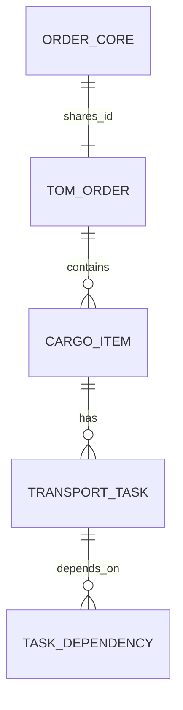

# 首片訂單資料模型 v0.1

日期：2026-11-17（Asia/Taipei）。主要任務：[Issue #4](https://github.com/xk2022/codex-xk-logistic/issues/4)。

依據：使用者「採用，下一步」已採用 [ORD-P01～P03](FIRST_SLICE_ORDER_SPEC.md)。本頁是供實作的工程模型；尚無 Entity、Migration、資料表或服務。業務已採用範圍與未決政策分開記錄，工程表示法不新增已核准現場規則。

## 聚合與關係

圖中的 task_dependency 每筆亦有 predecessor_task_id 指回同單任務；省略第二條邊以維持可讀性。草稿可有零項目／零任務；P02 完整性檢核要求至少一項目，且每項目至少一段標為必要的任務。所有子項在同一聚合交易保存，不以陣列排序推定執行先後。

| 表／責任 | 欄位映射與型別 | 約束 |
|---|---|---|
| order_core／OrderCore | id uuid、order_no varchar(100)、lifecycle_status varchar | id PK；order_no UNIQUE；新單 OPEN。CANCELLED／CLOSED 是唯讀契約保留值，本片無轉態動作。 |
| tom_order／TOM | order_id uuid、order_type varchar、customer_id uuid、customer_name varchar(200)、acceptance_status varchar、version bigint、customer_reference varchar(200)、remark varchar(4000)、shipping_present boolean 與船務欄位 | order_id 同時為 PK／FK → order_core.id；客戶 FK → CRM 權威主檔，建立或換客戶須有效且允許新增引用；新單 DRAFT／version=0。 |
| cargo_item／TOM | id uuid、order_id uuid、client_ref varchar(64)、sequence integer NULL、item_kind varchar NULL、container_type／container_no varchar(200) NULL、package_qty integer NULL、gross_weight／cbm numeric NULL、last_pickup_date date NULL、delivery_cutoff_at timestamptz NULL | PK id；FK order_id → tom_order.order_id；UNIQUE(order_id,id)、UNIQUE(order_id,client_ref)、UNIQUE(order_id,sequence)。sequence NULL 可多筆，有值為正整數；不建立歷史櫃號永久唯一。 |
| transport_task／TOM | id uuid、task_no varchar(100)、order_id uuid、item_id uuid、client_ref varchar(64)、task_kind varchar(200) NULL、起終點名稱 varchar(200)／地址 varchar(1000) NULL、contact_present boolean、contact_name varchar(200)／contact_phone varchar(50) NULL、planned_start_at／planned_end_at timestamptz NULL、required_task boolean NULL | task_no UNIQUE；UNIQUE(order_id,id)、UNIQUE(order_id,client_ref)；FK(order_id,item_id) → cargo_item(order_id,id)；有起訖時 end >= start；本片 required_task 只允許 true 或 NULL，無任意免除功能。 |
| task_dependency／TOM | order_id uuid、task_id uuid、predecessor_task_id uuid | 複合 PK 三欄；兩組 FK(order_id,task_id/predecessor_task_id) → transport_task(order_id,id)；CHECK(task_id <> predecessor_task_id)。跨列無環由 Service 在聚合交易內驗證，不用跨列 CHECK。 |

DB應以CHECK／型別約束保護已核定表示：type限IMPORT／EXPORT／LOCAL、item_kind限CONTAINER／CARGO或NULL、sequence／package_qty有值須為正整數、gross_weight／cbm有值不可負、required_task不得false、version在本契約安全整數範圍。應用層另驗字元／數值傳輸長度、同單圖與未決例外；不使用精度截斷或隱性四捨五入處理輸入。

每張表保存 created_at／updated_at timestamptz、created_by／updated_by uuid，由伺服器產生。task_dependency 有稽核欄位；複合 PK 是關係表的工程例外。UUID 版本、order_no／task_no 編碼演算法尚待工程實作定稿；本模型不沿用示例 DEMO 格式，也不採用外部指定 ID。

tom_order 的 nullable 船務欄位：shipping_company、vessel_voyage、pol、pod、bl_no 為 varchar(200)，eta／etd 為 timestamptz。shipping_present 與 contact_present 用於保留 API 的 null 與空物件區別：present=false 時對應子欄必須全 NULL；present=true 時輸出物件且各空欄回 null。港口目前是文字快照，沒有自稱已建港口主檔；一單多船期／提單仍待 D04。

## 識別與一次保存

- 輸入 item.clientRef、task.clientRef 是各自集合內、同單唯一的穩定參照；task.itemRef／predecessorRefs 必須存在於本次完整草稿內。clientRef 不是 UUID、單號或跨訂單定位權限。
- 服務先在授權範圍取得聚合，對既有 clientRef 保留原 UUID／taskNo，對新 ref 產生 UUID，再建立外鍵／依賴。回應含 ref 與正式 UUID，前端後續保存沿用 ref，不可送入 id、itemId、orderId、單號或稽核欄位。
- PUT 是完整替換。省略可選純量等同 null；items／tasks／predecessorRefs 省略等同空集合。可移除尚無任何執行資料的草稿子項，但該版快照保留；若有派工、執行、事件或其他不可移除關聯，整次回 409。未核准的執行資料刪除不在本片。
- 同單 sequence 有值時唯一；itemRef、前置 ref 不能指向其他單、自己或不存在的任務。依賴可跨同單不同項目，尚未確認的執行條件不因依賴圖存在而獲放行。移動既有任務至另一個同單 item 是未執行草稿編輯，記入版本歷程。

## 交易、版本與重送

以下為首次新寫入流程；同key成功重播先依API說明查授權與key紀錄，不先重驗現有客戶可引用性或expectedVersion。Service Interface＋Impl 控制交易：授權與有效客戶查核 → 取得聚合鎖／版本比對 → 檢查 OPEN＋DRAFT 且無執行資料 → 驗證整張輸入圖 → 寫 Core／TOM／項目／任務／依賴 → 寫不可變版本快照與重送紀錄 → 原子提交。客戶有效性需與停用操作協調鎖定或等效序列化，避免查核後被停用仍新增引用。

tom_order.version 是整個聚合的版本。任何成功的新 PUT（含只改子項）都增加一次；不能只依 JPA 子 Entity 的變更偵測讓父版本不變。舊 expectedVersion 回 409 VERSION_CONFLICT，不產生半筆資料。失敗時連 Core、快照、重送成功紀錄一起回滾；重送順序見 [API 說明](api/README.md)，成功重播不再增加版本。

| 技術紀錄 | 最小責任 | 未決界線 |
|---|---|---|
| order_draft_revision | id uuid、order_id FK、aggregate_version bigint、snapshot jsonb、request_trace_id、四個稽核欄位；UNIQUE(order_id,aggregate_version)。建立 version=0 及每次新 PUT 各存一份不可變讀回快照。 | 歷程查詢端點不在本片；保存／清理期限待 D10，沒有排程刪除。 |
| api_idempotency | id uuid、伺服器驗證的公司範圍、actor_id uuid、HTTP method／canonical_path／key、request_hash、order_id FK、original_status、原業務結果／Location、四個稽核欄位；scope＋actor＋method＋path＋key UNIQUE。 | 保存策略／容量待 D10；未核定前不自動過期或重用 key，不代表核准永久保存。執行中競爭需 bounded lock／等效機制，回 409，不允許兩次副作用。 |

草稿移除不 cascade 到執行／派工／資產；本片沒有那些表的 Migration，也不做 CRM／UPMS 的破壞性刪除。所有表名是新版目標映射，不是舊資料庫 schema 或搬遷完成證據。

## 格式與未知值

API 用 camelCase、DB 用 snake_case。重量 kg／體積 m³ 以非負十進位字串傳輸、Java BigDecimal／PostgreSQL numeric 計算與保存，不用浮點或字串算術；最多 32 字元是首版傳輸界線，精確業務上限／重量來源與空櫃例外仍待 D04。null 表未知；"0" 表明確已知零，不能拿零代填未知。讀回允許正規化小數尾零，不承諾保留輸入的顯示位數。

sequence／packageQty 的工程範圍為 1～2147483647；version 為 0～9007199254740991（前端安全整數界線），DB 用 bigint；不是現場作業配額。日期只用 date；日期時間要求 RFC3339 含 offset，小數秒最多6位，offset小時00～23／分鐘00～59，存timestamptz(6)（保留契約精度內的瞬間，不保證原offset字面；超過6位先拒絕，不無聲截斷或捨入），介面顯示 Asia/Taipei。空白名稱無效，未知請傳 null；對文字與陣列不做隱藏的業務轉換。

## 仍待處理

D02 逐動作授權與帳號政策、D04 字典／聯絡／重量／櫃號／多船期／期限例外、D07 正式資料是否接續及權威 schema、D10 保存與維運仍待確認。照片、出發、資源釋放、受理動作及結案屬後續契約；不能用本模型推定已核准或實作。原 [G1～G5](LOGISTICS_EXECUTION.md) 關聯門檻保留。

技術依據：[PostgreSQL 17 Constraints](https://www.postgresql.org/docs/17/ddl-constraints.html)、[Date/Time Types（1微秒解析度）](https://www.postgresql.org/docs/17/datatype-datetime.html)；API 對照見 [OpenAPI](api/openapi.yaml)。本次未執行 DDL／DB 交易驗證。
