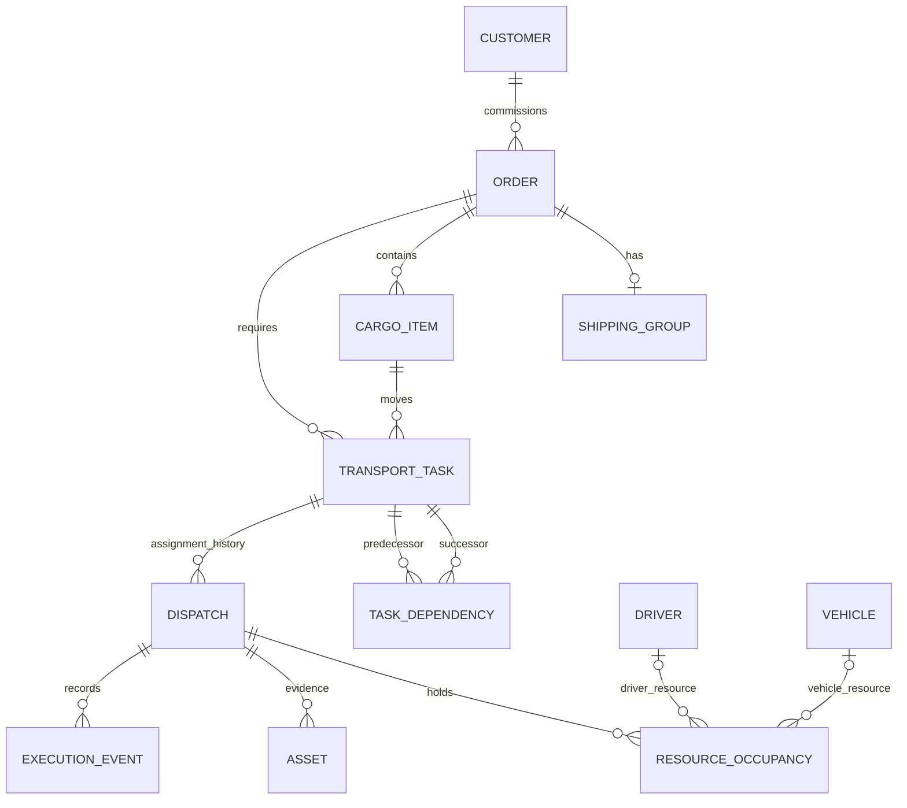
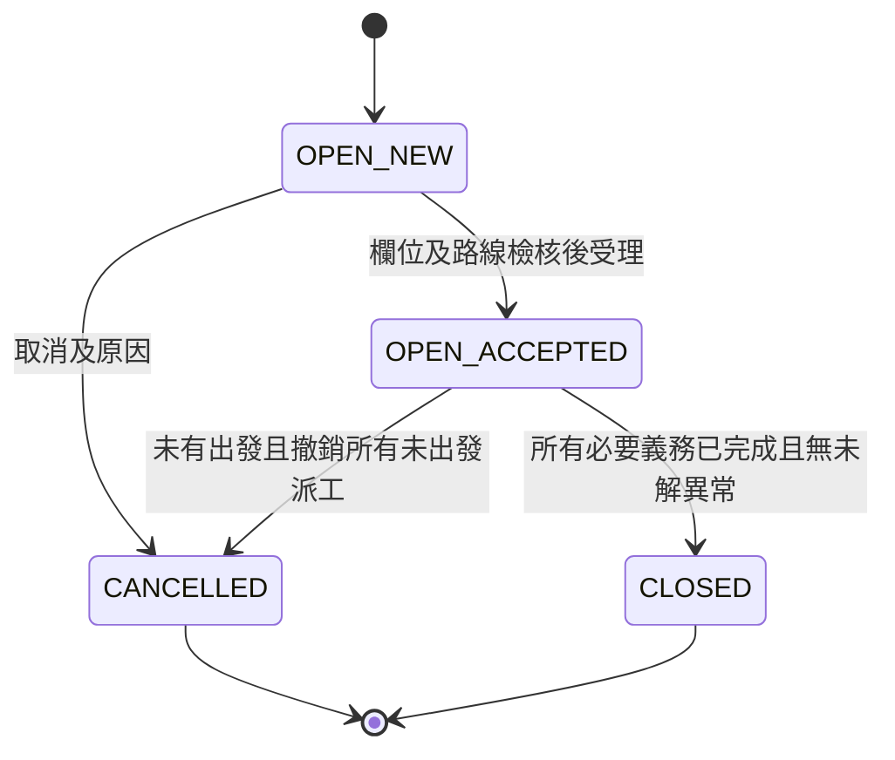
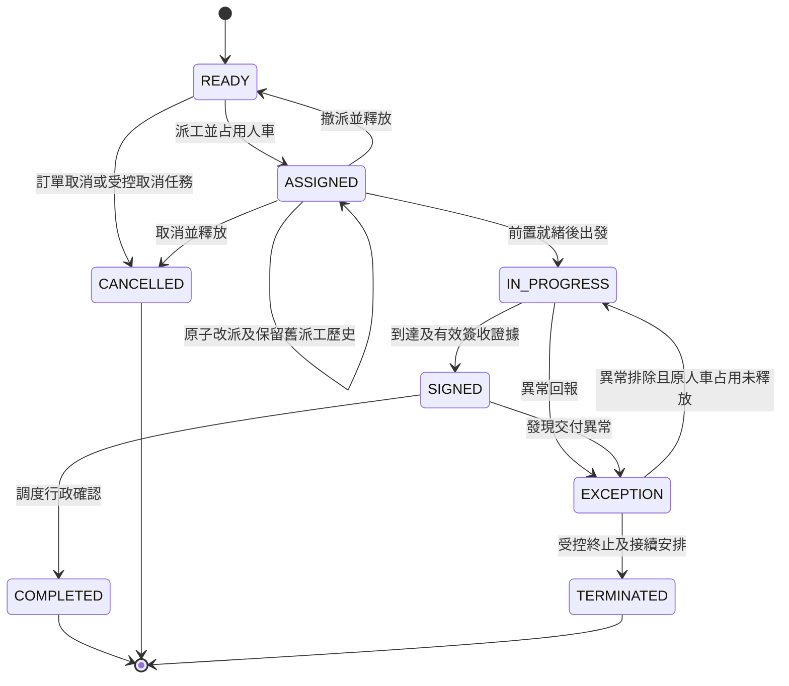

# L1｜通用物流業務模型與規則提案

狀態：規格提案，待業務確認；未實作、未執行產品驗收。使用者本輪已指定以「一單多櫃／多段」完成通用定義，但未核准本文的欄位必填性、釋放時點及異常政策。

來源：[來源盤點](01-source-inventory.md)、[差異分析](02-gap-analysis.md)、[資料與流程](04-domain-and-workflows.md)、[決策與驗收](06-decisions-and-acceptance.md)。本文延伸既有 D03／D04／D05／D09；不宣稱合成案例是現場作業證據，也不以本文替代正式資料表或 OpenAPI。

## 1. 通用邊界

- 訂單表達客戶的一次委託；訂單不直接綁死一位司機或一台車。
- 訂單有一至多筆貨櫃／貨物項目，以及一至多個必要運輸任務。草稿可尚未補齊；受理前至少有一項及一段。
- 每個任務只有一個起點、一個終點及一個標的項目。多櫃合載、多訂單併車、多站點路線最佳化不在本版模型承諾內；需要時另擴充裝載關聯，不將多個櫃號塞進字串。
- 同一項目可有多個順序任務，例如提重櫃、送達、還空櫃。任務用前置任務關聯表達依賴，不能只以列表排序判定可出發。
- 派工表達某段的司機、車輛及有效指派。歷史指派不覆寫；每個任務同時最多一筆有效執行指派。
- 「車輛」暫指可獨立調度的整車／車頭資源。板車分離、落板後車頭釋放、雙司機及換手半途接續，須另確認，不能套用整車釋放規則。
- 預定時間是計畫，不代表資源已預約。建議第一版只做即時有效占用，不做未來時窗預約；可先登記未指派計畫。
- 無訂單的空車／板車任務為 D03 的獨立子決策，本文保留概念，暫不以它繞過訂單受理與驗收。

## 2. 三筆合成案例

以下客戶、地點、識別及資源均為示意，不是實際客戶或可查驗櫃號。時間為 Asia/Taipei；資源僅在派工成功後占用。

| 案例 | 訂單與項目 | 任務與前置條件 | 派工及釋放示例 | 結案條件 |
|---|---|---|---|---|
| 進口 I-DEMO | IMPORT；示例客戶甲；兩櫃 C-I1（20GP）、C-I2（40HQ）；同一船務資料 | 每櫃兩段：港區提重櫃→甲倉；甲倉空櫃→還櫃場，共四段；各櫃第二段依賴第一段簽收及空櫃可提確認 | I1 第一段司機甲／車甲，I2 第一段司機乙／車乙；C-I1 送達且人車確認可離場後釋放，次日第二段可改由司機丙／車丙；尚未還櫃不能整單結案 | 四段皆行政確認完成，還櫃事件有時間與證明，無未解異常 |
| 出口 E-DEMO | EXPORT；示例客戶乙；一櫃 C-E1（40HQ），提櫃時才補實際櫃號 | 空櫃場→乙裝貨點、乙裝貨點重櫃→出口交櫃場，共兩段；第二段須第一段簽收、裝貨完成及交櫃條件具備 | 第一段司機甲／車甲；示例假設空櫃落地並確認人車可離場才釋放，若無法落地或仍待裝貨則保留占用；第二段可重新派另一組人車 | 交櫃段完成及交櫃證明齊備；不能把船舶實際離港當作本委託必然交付條件 |
| 國內 L-DEMO | LOCAL；示例客戶丙；貨物項目 G-L1，10 件、毛重 1,200 kg；無櫃號 | 丙倉→中轉倉、中轉倉→收貨點，共兩段；第二段依賴第一段簽收及中轉貨物可提確認 | 首段司機乙／車乙，卸貨並確認可離場後釋放；第二段司機丙／車丙。換手以新任務／新派工記錄，不覆寫第一段 | 兩段皆確認完成；中轉簽收不能代替最終收貨簽收 |

實際驗證時須由調度提供各一筆匿名真實案例，確認是否等候裝卸、是否車板分離、還櫃是否屬原委託及何人確認可離場。若還櫃不屬委託，應在受理時排除該必要任務並留原因，不能結案時臨時刪除未完成段。

## 3. 欄位矩陣

代碼：`建`＝建立時必填；`受`＝受理前必填；`派`＝該段派工前必填；`發`＝該段出發前必填；`簽`＝簽收時必填；`條`＝符合條件時必填；`選`＝選填；`—`＝不適用。所有必填時點均為提案，不是已核准現場規則。草稿容許晚補欄位，但不可因此跳過出發檢核。

### 訂單及船務層

| 欄位／單位 | 層級 | 進口 | 出口 | 國內 | 規則及用途 |
|---|---|---|---|---|---|
| id、orderNo、type | 訂單 | 建 | 建 | 建 | ID／單號由系統產生；type 為 IMPORT／EXPORT／LOCAL |
| customerId、名稱快照 | 訂單 | 建 | 建 | 建 | 有效客戶；名稱更新不改歷史快照 |
| customerReference、remark | 訂單 | 選 | 選 | 選 | 不以客戶參考號取代系統唯一單號 |
| shippingCompany、vesselVoyage | 船務組 | 受 | 受 | — | 一單一組船務作為起點；不同船期／航次拆單；未核准多組船務 |
| pol、pod | 船務組 | 受 | 受 | — | 裝／卸貨港，不等同該段陸運起終點 |
| ETA、ETD（含時區時間） | 船務組 | ETA 受；ETD 選 | ETD 受；ETA 選 | — | 預計船期，不當作實際派工時間 |
| shipDate（日期） | 船務組 | 選 | 選 | — | 若與 ETA／ETD 重複，契約定稿時選一種語意；不得混稱到港日 |
| blNo | 船務組 | 受 | 選 | — | 本提案一單一提單；多提單需求須確認 |
| deliveryOrderLocation、arrivalNotice | 船務組 | 選 | — | — | 換單地點／通知參考；不視為正式附件已上傳 |
| importDeclNo | 船務組 | 選 | — | — | 可選保存；提重櫃放行依下一列確認，不以有報單號自動推定放行 |
| customsReleaseTime、放行確認人／依據 | 船務組 | 發（提重櫃段） | — | — | 手動確認的放行證據，非海關串接；尚未放行可受理但不可出發 |
| clearanceDate、出口通關確認依據 | 船務組 | — | 發（交櫃段，條） | — | 是否必須通關後才可交櫃由現場確認；日期不能取代放行語意 |

### 項目、任務及執行層

| 欄位／單位 | 層級 | 進口 | 出口 | 國內 | 規則及用途 |
|---|---|---|---|---|---|
| itemId、itemKind、項目序號 | 項目 | 受 | 受 | 受 | CONTAINER／CARGO；訂單內序號唯一 |
| containerType | 項目 | 受 | 受 | 條 | 櫃運才適用；櫃型可不同，不寫在訂單單一欄 |
| containerNo | 項目 | 發（提重櫃段） | 簽（提空櫃段） | 條 | 未知時用內部 itemId；同單已知櫃號不得重複，跨單不永久唯一；格式檢核另定 |
| packageQty（件）、grossWeight（kg）、cbm（m³） | 項目 | 選；重量派 | 選；重量派（重櫃段） | 件數受；重量派；體積選 | 重量依計畫／實際分欄或來源標記；不可用空白代表 0，超載核對依車輛能力與現場規則另確認 |
| containerYard、warehouse、returnYard | 任務地點參照 | 受（對應段） | — | — | 分別落到提重櫃段起點、送貨段終點、還櫃段終點；不建立互相矛盾的重複地址 |
| pickupYard、loadingLocation、deliveryYard | 任務地點參照 | — | 受（對應段） | — | 分別落到提空櫃、裝貨與交櫃的起終點 |
| lastPickupDate | 項目作業限制 | 受 | — | — | 到期警示與逾期人工確認，不自行算滯箱費 |
| pickupCode | 項目作業資料 | — | 發（提空櫃段） | — | 司機只看到本人該段所需資料；不放公開查詢或日誌 |
| 交櫃截止時間／限制 | 項目作業限制 | — | 受 | — | 新增提案，來源為出口案例的必要限制；不得冒稱既有欄位 |
| taskId、taskNo、orderId、itemId、taskKind | 任務 | 受 | 受 | 受 | 每段一標的；taskKind 如提重／送達／還空／提空／交重／國內轉運，字典待確認 |
| 起終點名稱、地址、現場聯絡方式 | 任務 | 受 | 受 | 受 | 地址與名稱快照；聯絡方式按該段必要性提供，跨公司主檔不在本版 |
| plannedStartAt、plannedEndAt | 任務 | 派 | 派 | 派 | 結束不得早於開始；預計不等於占用時窗保證 |
| predecessorTaskIds、必要任務旗標 | 任務 | 受 | 受 | 受 | 依賴無環；同一訂單內；免除必要任務須受控原因與歷程 |
| readyAt／可提確認人、時間、備註 | 任務前置 | 發（條） | 發（條） | 發（條） | 空櫃、裝貨或中轉可提時點可晚於前段簽收 |
| dispatchId、driverId、vehicleId、assignedAt | 派工 | 派 | 派 | 派 | 後端檢查人車狀態及唯一有效占用 |
| startedAt、signedAt、resourceReleasedAt、completedAt | 執行事件 | 依動作產生 | 依動作產生 | 依動作產生 | 伺服器紀錄時間，補登實際作業時間另留操作者與原因 |
| 簽收結果、照片資產、備註 | 派工證據 | 簽 | 簽 | 簽 | 照片必填性、格式與手機驗收由 L2 決定；不將未完成上傳視為證據 |
| 釋放確認、異常類型、原因、處理人 | 執行事件 | 條 | 條 | 條 | 人車確可離場才釋放；故障不等於車輛可用 |
| version、createdAt／By、updatedAt／By | 各可變實體 | 系統 | 系統 | 系統 | 版本衝突不得默默覆寫 |

補登櫃號或變更地址不得改寫已出發段的執行快照；已出發後變更以異常／更正紀錄處理。不同航次、不同提單是否可同單、重量必填的作業例外，是 D04 的待決部分。

## 4. 資料關係

基數圖允許草稿尚無項目／任務；受理時再要求至少一筆。SHIPPING_GROUP 為概念分組，不預先指定獨立資料表。每個 TRANSPORT_TASK 的 itemId 必須屬於同一 orderId；依賴也不得跨訂單或形成環。RESOURCE_OCCUPANCY 每筆只屬於一種資源（driverId／vehicleId 恰一非空，XOR；圖中兩個可選關係不能同時成立）；同資源最多一筆未釋放占用。DISPATCH 的歷史數可多筆，但 ASSIGNED／IN_PROGRESS／SIGNED 待確認中的有效指派最多一筆；SIGNED 已釋放仍是同一指派的待行政確認，不能再為原任務另建有效指派。

## 5. 狀態與衍生進度

本文「簽收」及 SIGNED 是每段作業回報完成的通用狀態：送貨／國內運輸是交接或收貨憑證，提櫃／還櫃／交櫃是場站作業憑證，不一律要求客戶簽名。照片張數、格式及必填性以 L2 提案為準。補件不重新占用資源，也不任意退回執行階段；若交付本身有異常，另走異常處理。

訂單主狀態沿用 OPEN／CANCELLED／CLOSED；NEW／ACCEPTED 表達受理狀態。安排進度由任務衍生 NONE／PARTIAL／ALL，避免用訂單單一 ASSIGNED 掩蓋尚未派工的其他櫃段。撤派後依現況重算安排進度，不取消已受理事實。

此圖是任務對外呈現的執行階段；有效派工是執行事件來源，不另維護可任意編輯的第二套相反狀態。撤派／改派使舊派工成為 WITHDRAWN／REPLACED；它們不代表任務永久取消。TERMINATED 不是 COMPLETED，必須建立接續任務並經調度確認原必要義務如何承接，才能解除訂單結案阻擋；原始歷史不覆寫，保存期限另依核定政策。結案時每項必要義務須有 COMPLETED 任務，或有受控終止紀錄及核准的替代任務對照，且替代任務全部 COMPLETED；TERMINATED 本身不算完成，也不得用取消必要旗標規避。

## 6. 占用、釋放與撤改派提案

建議將「物理作業完成並確認人車可離場」與「行政完工確認」拆開。SIGNED 不能自動推定資源可用；司機簽收時另確認人車可離場，伺服器同一交易寫入釋放事件。未確認者保留占用，調度核對後可單獨釋放。行政 COMPLETED 不需要等人車仍在場。EXCEPTION 恢復 IN_PROGRESS 僅限原派工人車占用從未釋放、仍歸該派工且無其他有效指派；任一資源已釋放便不可復活原派工，應受控終止並新建接續任務，重新檢核與占用。已釋放資源正在下一單時，原單的補件或異常不得取回其占用。

| 動作 | 前提 | 占用／釋放 | 失敗與歷史 |
|---|---|---|---|
| 派工 | 訂單 OPEN＋ACCEPTED、任務 READY、欄位具備；人車可用，司機 ACTIVE＋onDuty | 成功時同交易占用司機及車；第一版不可藉未來日期重複占用 | 任一資源衝突全部不成立；保留 requestId，衝突 409 |
| 出發 | 目前有效指派為 ASSIGNED、本人或獲准代操作；前置段已簽收且其交接已就緒、尚無未解異常 | 延續既有占用，不新增第二筆 | 前置段只需作業與交接完成，不必等待行政 COMPLETED |
| 出發前撤派 | ASSIGNED、原因必填 | 原指派 WITHDRAWN、人車占用釋放、任務回 READY | 全部同交易；不能只刪派工或漏釋放 |
| 出發前改派 | ASSIGNED、新人車可用；原因、版本必填 | 舊指派 REPLACED；新指派 ASSIGNED；同交易換占用；同一人或車保持連續占用 | 新資源取不到則舊指派／占用完全保留；不先撤舊再嘗試派新 |
| 簽收並可離場 | IN_PROGRESS、證據有效、實際作業完成、無未解阻擋異常 | SIGNED＋releaseConfirmed；原子釋放人車；下一段仍須另派工 | 上傳／證據未完成不能假釋放；照片上傳本身不釋放 |
| 簽收但等待離場 | 已到達但仍待卸／待裝、車板未能脫離或其他占用原因 | 可記到達事件；若交付尚未完成不得 SIGNED；若已簽收但不能離場則保留占用 | 調度核對後以專用釋放動作留理由，不改寫簽收時間 |
| 行政確認完成 | SIGNED、證據及必要欄位完整；釋放已確認 | COMPLETED；已釋放不得再次影響資源 | 發現錯誤先異常處理，不把原資源重新占用回已執行下一單的車司機 |
| 訂單取消 | 所有任務皆未出發；無已簽收／已完成段 | 同交易取消訂單及未出發必要任務，撤銷有效指派並釋放 | 不隱含取消已執行的歷史；有出發紀錄改走異常終止 |
| 出發後故障／換手 | IN_PROGRESS／SIGNED；異常及現場接續確認 | 不直接改派；原任務阻擋、以接續任務接手；釋放須逐項確認 | 車故障釋放占用後設 MAINTENANCE，不能變 AVAILABLE；司機可獨立確認可用；板車若獨立管理需另案 |
| 司機下線／帳號停權 | 可禁止新派工或操作 | 不自動釋放正在執行的占用 | 調度接管異常；不可讓停權變成無人承接的資源釋放捷徑 |

交易必須共同保護任務版本、有效指派、資源占用、狀態事件及歷程。固定鎖定順序，資料庫約束或等效機制確保唯一有效占用；提交前再次檢核。Idempotency-Key 相同內容重送回原結果，不重複歷程／指派／釋放；同 key 不同內容回 409。任何步驟失敗整體回滾。照片二進位儲存與資料庫不假裝可共享交易：先完成驗證資產，再引用它提交簽收交易；孤兒上傳由獨立保留／清理規則處理，不能把清理當成簽收成功。

## 7. 驗收條件與待決

以下是未來測試規格，目前全部「未執行」；文件閱讀不能視為系統通過。

| ID | 可觀察條件 | 對照 |
|---|---|---|
| L1-01 | 建立 I-DEMO 的兩櫃四段；各段可用不同司機車輛；完成首段後訂單仍 OPEN，未還櫃不可關單 | D03、A09 |
| L1-02 | E-DEMO 可先以 itemId 建立，提空櫃簽收補號；同單重複櫃號拒絕；不同歷史訂單同櫃號不被永久唯一限制 | D03／D04 |
| L1-03 | L-DEMO 不要求船務及櫃號；缺必要起終點／重量不可派工；跨日時間依台北時區顯示及篩選 | D04、A13 |
| L1-04 | 依賴有環、項目跨訂單、前置尚未交接就出發均拒絕；前段已簽收可離場但未行政完工時可執行後段 | D03／D09 |
| L1-05 | 兩個請求同時搶同一人或車，只有一個成功；另一個 409，沒有半筆人車占用 | D09、A03 |
| L1-06 | 出發前撤派回 READY，舊派工及原因可查；舊占用全釋放、受理事實保留、安排進度重算 | D05、A10 |
| L1-07 | 改派新車已被占用時整體失敗，舊人車及指派保持；成功時只有新有效指派，未留下舊占用 | D05／D09、A10 |
| L1-08 | SIGNED 可離場釋放後可派下一單；後台 COMPLETED 重送不影響下一單占用；SIGNED 尚未可離場仍不能搶占 | D09、A08 |
| L1-09 | 出發後直接 cancel／replace 被拒；故障留史、車轉維修、接續任務及義務對照可查；未解異常不可結案；已釋放派工進入異常後不可恢復 IN_PROGRESS，接續必須重新合法派工 | D05 |
| L1-10 | 派工、改派、撤派、簽收、釋放各以注入交易失敗驗證全回滾；同 key 重送一次副作用，舊 version 被拒 | A04／A08／A11 |
| L1-11 | 進口未放行不可出發提重櫃；出口交櫃前依核定規則驗證通關／截止條件；缺照片依 L2 決策阻擋簽收 | D04／D06、A07 |
| L1-12 | 已有完成段的訂單不能直接取消；終止段未有核定接續義務處置不能結案；所有必要段完成且無異常才能 CLOSED | D05、A02／A09 |

| 決策 | 本文建議 | 仍需業務決定的最小資訊 |
|---|---|---|
| D03 | 一單多項目多段，一段一標的；前置關聯；不同船期／提單先拆單 | 各一筆匿名真實案例是否符合；是否必須支援併櫃、多提單、無訂單空車／板車及車板分離 |
| D04 | 依建立／受理／派工／出發／簽收分時點驗證 | 欄位矩陣逐項例外，出口通關與交櫃關係，未知重量／未知櫃號作業方式 |
| D05 | 出發前原子撤改派；出發後異常及接續，歷史不改寫 | 誰有權終止／免除必要段，故障換手的現場交接與責任確認 |
| D09 | 即時占用；物理作業完成且可離場才釋放，行政確認分離 | 簽收與可離場由誰確認；是否需要未來預約、裝卸等待及車頭／板車分離 |

下一步由執行總管集中取得上述資訊，將核准內容回寫正式決策紀錄，再定資料表、API 與程式排程。
