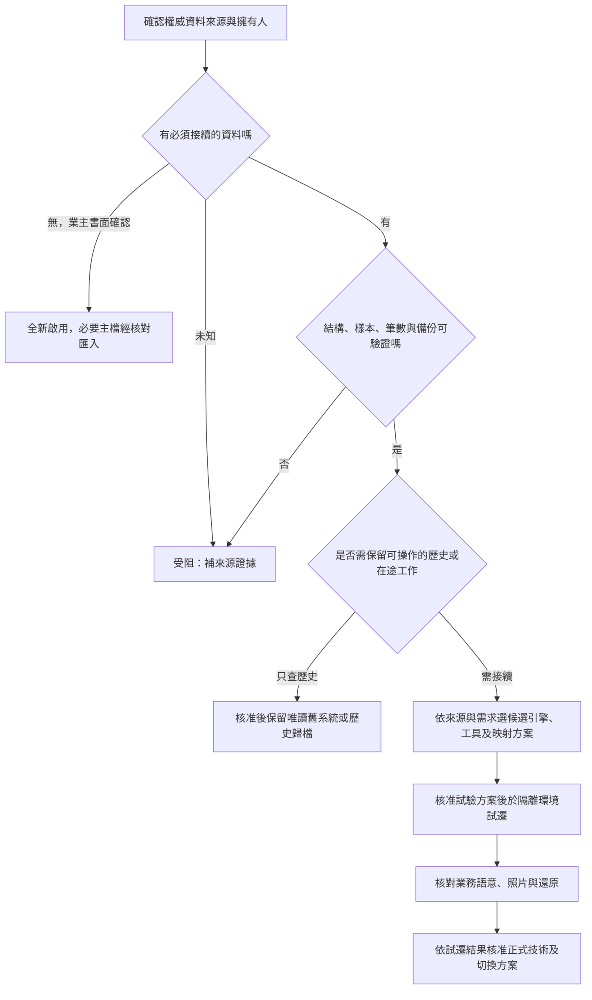

# L3｜新舊接續、資料來源與技術決策

狀態：規格提案；本次已確認「先確認資料來源，再決定搬遷方式與技術」。D01、D07 仍待決，未核准技術棧、正式搬遷或沿用任何安全設定。新版程式排在 L1～L4 規格決策後。本文件只交付盤點、決策門檻與驗收設計。

## 已核對的證據與限制

- 本輪重新以唯讀用途取得 [G1 固定版本 9a967bfc](https://github.com/xk2022/xk-truck-platform/tree/9a967bfc1b56fdccac6376fd08b7a6083582c876)，不是以其目前 main 代替。
- 核對 `xk-truck/src/main/java/com/xk/truck/tom/controller/api/TomOrderController.java`：啟用建立訂單入口；列表、明細、派單等入口被註解。這不是完整可用 API 的證據。
- 核對 `.../tom/domain/model/TomOrder.java`：訂單共用 orderUuid、客戶快照與單一起終點；accept、markAssigned 有前態檢核；ASSIGNED 後禁止取消。不能直接表達新版多櫃多段與撤改派規則。
- 核對 `.../fms/domain/service/DispatchService.java`：assign 直接儲存；start、sign、complete、cancel 直接設定狀態。此類別內未見前態、資源占用與照片完成檢核，不能當作新版調度閉環沿用。
- 核對 G1 的 `xk-truck/pom.xml`、`xk-base/pom.xml`：有 JPA、MySQL driver、Spring Security 及 jjwt 依賴；依賴存在不證明資料庫內容、正式版本、權限或執行可用。
- G2 固定版本與本機來源僅沿用 [來源盤點](01-source-inventory.md)、[差異分析](02-gap-analysis.md) 的既有靜態摘要，本輪未重驗其執行結果。本機 L8 前端、實際舊 DB、NAS、正式照片均未取得。

來源盤點的 L1～L9 是「舊來源代號」，與本次四條工作線 L1～L4 不同。不得把舊來源 L1 當成本次業務模型工作線。

## 「沿用／重寫／不帶入」對照

「沿用」在本階段表示保留需求或設計概念，不表示已複製可執行程式。任何逐段程式沿用都須在規格核定後通過授權、相依性與測試檢查。

| 來源／項目 | 處理 | 證據、原因與邊界 | 後續驗收 |
| --- | --- | --- | --- |
| G1 CRM／TOM／FMS／OrderCore 領域名稱 | 沿用概念 | 與既有規格一致；模組名稱不能代替實際跨域交易設計 | L3-03 |
| G1 訂單 UUID、對外單號、客戶名稱快照 | 沿用語意 | TomOrder 可見；客戶異動不得重寫歷史訂單快照 | L3-03、L3-06 |
| G1 IMPORT／EXPORT／LOCAL 類型 | 沿用語意 | 映射到 L1 欄位矩陣，逐欄確認，不沿用單一起終點限制 | L3-03 |
| G1 TomOrder／DispatchTask 資料結構 | 重寫 | 多櫃、多段、任務與多次派工需拆分；不能直接一筆訂單對一筆派工 | L3-03、L3-06 |
| G1 派工與狀態操作、取消處理 | 重寫 | DispatchService 的直接改狀態與 TomOrder 取消限制須統一為 L1 狀態機、占用交易與歷程 | L3-03、L3-07 |
| G1 Controller／DTO／Repository | 重寫契約；逐段評估工具碼 | 註解入口不是功能；新版 API、欄位範圍、錯誤與授權須一致，禁止直接開啟舊入口當完成 | L3-03 |
| G2 前後端分離、契約與遷移交付方式 | 沿用方法 | 已確認參考方向；不等於 PostgreSQL、JDBC、Session 已核准 | L3-04 |
| 本機舊 MVC 與 Java 8 專案 | 不帶入新版執行碼 | 僅追溯用語與資料來源；未取得可重現版本且與新版分離架構不同 | L3-01、L3-03 |
| 本機 L8 React 頁面動線、進出口／貨櫃欄位 | 沿用需求；重寫實作 | 現只有摘要；取得原碼後另查型別、假資料分支、相依性與資產授權 | L3-02、L3-03 |
| 舊 UI Mock／模擬成功、混用 ID 與狀態型別 | 不帶入 | API 失敗不可變假成功；轉換必須明確且可追溯 | L3-03、L3-06 |
| 商業模板與其圖片、字型、外掛 | 不帶入，直到授權證實 | 不能以舊目錄存在推定可再散布；可自行建立元件 | L3-02 |
| 舊帳密、Token、連線設定、環境檔 | 不帶入 | 不複製至新庫／文件；未來依核准方式重新配置與輪替 | L3-02 |
| 舊密碼雜湊、Session、登入 Token、有效占用 | 不直接帶入 | 密碼相容與帳號復原另決；Session 失效；實際在途工作需切換清冊核對，不複製舊鎖 | L3-05、L3-07 |
| 舊客戶／車司機／訂單／照片 | 待來源確認後決定 | 不列「全部搬」或「全部不搬」；按保留義務、業務必要與品質分表評估 | L3-01、L3-06 |
| node_modules、target、建置輸出、舊完成率 | 不帶入 | 相依性依鎖檔重建；歷史報告不能作新版完成證據 | L3-02、L3-04 |

## 資料來源確認表與責任

目前沒有任何一套資料庫被確認為正式搬遷來源；GitHub 原始碼不等於 DB。以下角色責任是提案，具名人員尚待業主指定。由業務資料負責人確認「哪套是權威」，技術維護人提供非機密結構與去識別樣本，執行總管整合證據；AI 不代替資料擁有人認定來源。

| 必須確認的項目 | 目前證據 | 要取得的安全輸入 | 對搬遷的影響 |
| --- | --- | --- | --- |
| 現在實際作業系統與資料擁有人 | 只有多套舊專案盤點，未確認哪套仍營運 | 系統名稱、維護角色、最後營運日期、權威來源聲明 | 無法確定時停在來源盤點，不做 DB 選型或搬遷承諾 |
| DB 引擎、精確版本、字元集與時區 | G1 有 MySQL driver，不代表正式 DB | 去機密 DDL、版本資料、表／索引／約束清單 | 評估 MySQL 延續或跨引擎轉換成本 |
| 範圍、筆數與成長量 | 未知 | 各表筆數、最早／最新日期、每日增量、尖峰使用量 | 決定全量、增量、停機窗口與費用 |
| 主鍵、業務鍵、關聯與重複資料 | 只有欄位候選摘要 | 去識別樣本、孤兒／重複統計、狀態字典、刪除標記 | 建立 source_system＋source_id→new_uuid 對照與隔離規則 |
| 在途訂單／未結任務／實際占用 | 未知 | 切換時在途清冊、實際司機車輛與業務確認人 | 決定舊系統做完或受控接續，禁止自動重派 |
| 圖片、簽收檔與訂單關聯 | 未知 | 去識別檔案清單、相對位置、大小／hash、資產歸屬、保存義務 | 決定物件儲存匯入與缺件處理，不搬舊公開連結權限 |
| 舊資料保留／刪除義務 | 未知 | 業主核定的期間、爭議保留及存取規則 | 決定搬主檔、近年歷史或只保留唯讀舊系統 |
| 可還原備份與切換條件 | 未驗證 | 備份格式與時間、隔離環境還原報告、可接受停機與資料損失 | 未通過還原不進正式移轉；與 L4 復原驗收一致 |

只收 DDL、去識別樣本與統計，不在 Git 放 DB dump、真實客戶個資、憑證或照片。正式連線權限另走核准與安全設定，不在聊天索取密碼。

## 搬遷決策分流

候選方案比較：

| 方案 | 適用條件 | 代價與驗收重點 |
| --- | --- | --- |
| 不搬歷史，新系統新開單 | 業主確認無必須接續資料，舊資料保留方式已核定 | 不能丟棄法定／合約資料；主檔與重複識別仍要核對 |
| 主檔＋切換後新單；舊單在舊系統做完 | 允許並行且有明確單號分界 | 兩套排車需統一人工占用清冊，避免同車司機重派；設定停止舊系統新增日期 |
| 主檔＋選定歷史＋在途接續 | 確需統一操作，欄位與狀態可映射 | 成本最高；在途逐單簽核、照片缺件／舊狀態無法映射時隔離，不強行補假資料 |
| 全量歷史唯讀歸檔＋新版營運 | 需查歷史但不需新版狀態操作 | 歸檔查詢、資料授權與還原也須維運；不宣稱歸檔就是完整可操作搬遷 |

優先用可重跑的批次與短暫凍結切換；是否需要增量／CDC 必須由實際資料量與可停機窗口證明。未核定前不建立雙寫，不依程式碼猜測表結構。

## 技術選型比較與決策門檻

以下是候選比較，不把 DB、認證與資料存取綁成同一決定。對應 [D01／D07](06-decisions-and-acceptance.md)。原規格中的版本只是當時候選；精確受支援版本要在規格核准後依官方支援與依賴相容性重新查核。

| 決策 | 候選與利弊 | 本輪結論與必要門檻 |
| --- | --- | --- |
| 整體結構 | 前後端分離＋模組化單體利於跨派工交易；微服務增加維運與分散交易成本 | 保持前後端分離方向；先用模組化單體評估，除非容量或組織需求證明需拆分 |
| 後端 | Java／Spring 可參考 G1；改其他語言須重建領域與團隊能力 | Java 是候選，並非本 repo 已有專案；待維護者能力、部署資源及最小驗證切片評估 |
| 前端 | React／TypeScript 可參考 L8／G2；舊模板沿用受授權與品質限制 | TypeScript 遵循專案規範；框架與 UI 套件於 MVP 頁面核定後定案 |
| DB | 保留 MySQL 降低既有 DB 語意轉換；PostgreSQL 對齊 G2，但須驗證日期、decimal、排序、索引與鎖語意 | 先完成來源確認表；無正式資料不構成「必須保留 MySQL」，有 MySQL 也不構成「必須換 PostgreSQL」 |
| 資料存取 | JPA 符合中央偏好；JDBC 明確 SQL；MyBatis 適合複雜動態查詢 | DB 不自動決定 ORM；先列交易與查詢需求，偏離既有規範須 ADR 決策 |
| Schema 版本管理 | Flyway 或相容版本化工具；跨引擎時另有資料轉換批次 | 候選尚未核准；須空庫可重建、升級可測、資料轉換可重跑，禁正式 ddl-auto=update |
| 認證 | 同源 Web 的 Session＋CSRF；獨立外部 App／API 可能需要 token | 以 L2 的角色、手機瀏覽器與外部入口範圍決定；不直接搬舊 JWT、密碼或安全設定 |
| 照片 | S3 相容物件儲存利於擴充；NAS／本地檔需備援與對外可用性 | 依 L4 容量、保存與還原責任決定；DB 只存資產 metadata 與歸屬，實際方案待核定 |

決策順序：L1 關聯／狀態與 L2 範圍收斂 → 來源與資料品質確認 → L4 可用主機、容量與維護能力 → 逐項 ADR 決策 → 授權後最小切片驗證 → 再估開發與搬遷工期。既有 DB 來源未明時，可比較技術但不定案搬遷方式，也不建立新版程式。

## 試遷、切換與回復規格

1. 建立來源清單與 manifest：來源版本、快照時間、表／檔數量、hash、去識別規則；保留不可變來源副本，不寫回舊 DB。
2. 建 mapping 規格：每欄來源、目的、型別／單位／時區、空值、轉換、預設原因、狀態對照及拒絕條件。禁止以預設 COMPLETED 掩蓋不明狀態。
3. 隔離環境由空庫建 schema，輸入同一來源兩次：第二次不得多建 UUID、訂單、照片或有效占用；保留 source_system＋source_id 的唯一映射與批次 ID。
4. 核對「來源總量＝成功＋隔離＋核准排除」；所有差異須有原因與業務簽核。檢查重複業務鍵、孤兒、日期、重量小數、客戶快照與照片 hash，不能只看總筆數。
5. 在途接續逐單比對必要任務、已完成段、有效派工、實際車司機與照片。舊鎖不搬；只有核准清冊才在新模型重建有效占用。同車司機衝突禁止上線。
6. 切換前在隔離環境還原來源及目標備份，記錄時間與完整性；業主批准窗口後才凍結舊系統新增／修改並取最終快照，執行最終核對。正式操作另需授權。
7. 回復窗口內保留舊系統唯讀與切換前備份。若新版尚無新寫入，可按核定步驟恢復舊系統服務；已有新寫入時先停止兩邊寫入、導出差異與逐單對帳，再決定補回或向前修復，不能直接回切造成新單遺失。
8. 回復觸發條件提案：未解占用衝突、必要資料／照片缺失、權限越界或核對未達核定標準。恢復服務與資料重整的執行人、核准人由 L4 責任表指定；未具名不得正式切換。

## 驗收條件與目前證據

以下是未來驗收規格，並非本次已執行搬遷或程式測試。

| ID | 驗收條件 | 完成證據／目前狀態 |
| --- | --- | --- |
| L3-01 | 業務資料負責人確認權威來源、需搬範圍、保留義務及在途接續方式 | 需來源確認表與具名核定；目前受阻於來源未知 |
| L3-02 | 每份欲沿用原碼／資產有版本、授權、相依性與敏感內容檢查；未通過不複製 | 需資產清冊與檢查報告；本次只核對 G1 指定檔，未拷貝舊碼 |
| L3-03 | 新模型與 API 不保留一單一派工限制；狀態／占用符合 L1，範圍符合 L2 | 需規格逐項對照與授權後測試；本次提供差異對照 |
| L3-04 | DB、框架、資料存取、認證、儲存分別有 ADR，列版本支援、選項、取捨與核准人 | 需來源與 L1／L2／L4 決策後執行；目前未定案 |
| L3-05 | 空庫結構可重建；同一試遷批次重跑不重複，故障重試不產生半筆業務或有效占用 | 需隔離環境執行紀錄及重跑差異；目前未執行 |
| L3-06 | 來源總量可對平；每筆新資料可追溯；重複／孤兒／無法映射均隔離；日期小數、照片 hash 與歸屬核對 | 需 mapping、manifest、差異與業務抽查簽核；目前無資料可試遷 |
| L3-07 | 在途清冊逐單簽核；每任務至多一有效派工，車／司機無衝突，舊端停止新增邊界可證明 | 需業務清冊與交易／競爭測試；目前未執行 |
| L3-08 | 切換前備份可還原；演練涵蓋無新寫入回切與有新寫入對帳，實測符合 L4 核定 RPO／RTO | 需還原計時、完整性與差異處理紀錄；目前未執行 |

## 待決事項與解鎖輸入

本工作線目前可以完成規格與來源差異，不能完成正式技術定案或搬遷驗收。下一個必要輸入是：現行正式系統名稱、資料擁有人／技術維護人、是否有必須保留或接續的舊單與照片。確認後由維護人提供去機密結構、去識別樣本與統計，再選搬遷分流；不要求先提供正式密碼或整庫個資。
